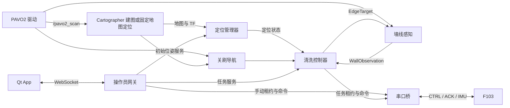

# 项目架构与代码导读

核对日期：2026-10-31。本文依据当前源码、launch、YAML 与测试整理。操作入口见[根 README](../README.md)，目标机安装见[部署指南](../DEPLOY_NANO.md)。历史验证记录只说明当时的测试结果，不能用来证明当前实船状态。

## 1. 项目组成与依赖

项目是 ROS 2 Humble 水面清洗机器人系统：Nano 执行传感器接入、建图定位、任务控制和串口通信；Windows Qt App 通过 WebSocket 操作 Nano，不需要 ROS。底层 F103 固件不在本仓库，`maps/` 也不纳入 Git。

| 包或目录 | 主要代码 | 职责 |
|---|---|---|
| `f1_lidar_driver` | [pavo2_scan_node.cpp](../src/f1_lidar_driver/src/pavo2_scan_node.cpp)、`vendor/pavo2_sdk/` | 连接雷达、发布扫描，不发布安装 TF |
| `f1_mapping_bringup` | [lidar_mapping.launch.py](../src/f1_mapping_bringup/launch/lidar_mapping.launch.py)、`config/pavo2_2d.lua` | Cartographer 纯雷达建图、地图发布、平面安装 TF |
| `f1_localization` | [localization_node.py](../src/f1_localization/f1_localization/localization_node.py)、`localization.py`、`map_io.py` | 冻结地图、初始位姿、轨迹生命周期、定位门控和栅格读取 |
| `f1_pool_cleaning` | [controller_node.py](../src/f1_pool_cleaning/f1_pool_cleaning/controller_node.py)、`autonomous.py`、`mission.py` | 矩形任务及两类任务共用的控制、导航、覆盖、感知实现 |
| `f1_l_cleaning` | [controller_node.py](../src/f1_l_cleaning/f1_l_cleaning/controller_node.py)、`route.py`、`topics.py` | 继承共享控制器，提供开放 L 路线及 `/l_cleaning/*` 接口 |
| `f1_nano_bridge` | [node.py](../src/f1_nano_bridge/nano_ros_bridge/node.py)、`session.py`、`protocol.py`、`transport.py` | 控制租约、协议编解码、串口、CTRL/ACK、IMU 遥测 |
| `f1_interfaces` | `msg/`、`srv/` | 公共消息与服务定义；修改后需要重建使用方 |
| `f1_operator_gateway` | [node.py](../src/f1_operator_gateway/operator_gateway/node.py)、`task_control.py`、`runtime.py`、`map_store.py`、`tracks.py` | 手动会话、任务操作、受管进程、地图保存与轨迹遥测 |
| `operator_app` | [window.py](../operator_app/window.py)、`transport.py`、`map_canvas.py`、`mapping_panel.py` | Qt 界面、WebSocket、地图交互、建图选图；不持有硬件 token |

`f1_localization` 依赖接口和建图配置包，建图配置包再依赖雷达驱动。因此 `--packages-up-to f1_localization` 当前构建四个仓库包；`--packages-up-to f1_operator_gateway` 构建全部八包。构建依赖并不意味着 launch 会启动所有依赖节点：雷达始终独立运行。

## 2. 数据与控制流



图中的网关任务服务调用与初始位姿调用分别进入控制器和定位管理器。IMU 由桥发布，但当前建图和固定地图定位均不融合 IMU 或轮速。TF 链为 `map → odom → base_link → pavo2s_frame`；雷达静态安装参数来自 `f1_mapping_bringup/config/lidar_planar.yaml`。建图 Lua 的跟踪帧为 `pavo2s_frame`，纯定位 Lua 的跟踪帧为 `base_link`，对外船体位姿都使用 `map → base_link`。

## 3. 入口选择与进程归属

| 入口 | 启动内容 | 使用前提 |
|---|---|---|
| `f1_lidar_driver lidar.launch.py` | 仅雷达驱动 | 没有同一设备的常驻驱动实例 |
| `f1_mapping_bringup lidar_mapping.launch.py` | 建图、地图发布、可选安装 TF/RViz | 已有扫描，未运行固定地图定位 |
| `f1_localization localization.launch.py` | 冻结地图定位和门控 | 地图三件套与扫描已准备 |
| `f1_pool_cleaning pool_bringup.launch.py` | 定位、bridge、矩形感知与控制器 | 传入适配矩形任务的 `map:=` |
| `f1_l_cleaning l_bringup.launch.py` | 定位、bridge、L 感知与控制器 | 传入适配开放 L 的 `map:=` |
| `f1_operator_gateway operator_gateway.launch.py` | 仅网关 | 复用已运行的 ROS 节点 |
| `f1_operator_gateway operator_bringup.launch.py` | 共享定位、bridge、可用任务及网关 | 指定已有地图，任务能力按几何校验决定 |
| `f1_operator_gateway operator_system.launch.py` | 常驻 bridge/网关，按 App 操作启动模式子进程 | 指定绝对 `workspace_root:=`，可无地图待机 |

清洗包的 `pool_cleaning.launch.py` / `l_cleaning.launch.py` 仅启动感知与控制器，默认配置仍需 `map:=`，并复用外部定位和 bridge。单独矩形定位前缀为 `/pool_cleaning`，单独 L 为 `/l_cleaning`，网关组合与受管入口为 `/f1_localization`。

受管入口通过 `runtime.py`、`managed_process.py` 和 `operator_mode.launch.py` 管理“待机／建图／固定地图定位与清洗”。建图和定位互斥，加载地图后重新发布初始位姿。地图导出由 `map_store.py` 保存同名 `.pbstream/.yaml/.pgm`，临时快照和日志的恢复规则见[网关说明](../src/f1_operator_gateway/README.md#地图文件与恢复)。

同一机器人仅启动一套 bridge 和地图/定位发布链。默认 launch 的 `output_enabled=false`；`pool_nano` 快捷脚本默认传 `true`，仓库 `f1-operator.service` 模板也设置 `F1_OUTPUT_ENABLED=true`。预览时要在使用的入口明确核对该值。所有入口均等待操作请求，不会仅因启动就自动清洗。

## 4. 地图和参数如何进入控制器

1. `map_io.py` 解析地图文件、读取栅格和最大空闲连通域；定位由这些数据计算范围门控。
2. `map_profile.py` 推导矩形四边或唯一合格的顺时针 L 墙角；`map_profile <地图>` 可离线查看结果。
3. `PoolController._map_geometry()` 先要求对应任务的地图推导成功，再把几何值作为 ROS 参数默认值。
4. 参数 YAML 的显式几何值可以覆盖这些默认值，但不能绕过第 3 步的失败。启动文件传入的同名显式参数又会覆盖 YAML，例如 `output_enabled`、`start_policy` 和 `default_edge_id`。
5. `edge_task_enabled=true` 且传入地图时使用 `AutonomousMission`；无地图的旧任务/测试模式使用 `Mission`，必须自行提供完整几何，不能照搬默认 launch 省略地图。

默认配置不保存历史地图尺寸或 L 坐标。更换地图时更新路径并核对现场 YAML 是否残留旧覆盖；地图几何与船体、刷盘、墙距策略是不同配置来源。控制器主要参数为只读，修改后需要重启对应节点。

## 5. 自动任务和停止语义

`AutonomousMission` 负责选起始边、后台规划、关刷导航、找墙及覆盖回补；`Mission` 负责沿墙纠偏和相邻边后退右推/右转。详细状态流见[清洗流程图](pool_cleaning/WALL_CLEANING_FLOW.md)。

默认自动选边先尝试船体当前左侧墙，再尝试其他墙，各组按有限墙段距离、航向差、边 ID 排序。显式 `set_edge` 或 `start_policy=specified` 使用指定边，不可达时不改选其他边。开始前检查定位、位姿和原始扫描，开始后才规划并获取目标墙线；`can_start=true` 不保证规划一定成功。

覆盖由 `coverage.py` 和 `AutonomousMission` 统计左刷接触中心线区间。当前默认缺口容差为 0.05 m，最多回补 2 轮；仍有缺口则 `PAUSED`，全部要求区间满足后才 `COMPLETE`。L 只有两条清洗墙，末端返回起点使用关刷导航，不增加 C→A 墙边。

| 操作或状态 | 行为 |
|---|---|
| `pause` | `PAUSED`，关闭输出并释放任务租约；需 cancel 后重新 start |
| `stop` | `STOPPED`，关闭输出并释放任务租约，保留进度快照；可 start 新任务 |
| `cancel` | `CANCELLED`，关闭输出并释放任务租约，另清除边关联与指定起始边 |
| 新的自动任务 `start` | 重新检查条件、重置进度并生成新 `run_id`，不支持断点续跑 |
| App `manual_stop` 或断线 | 停止网关手动会话；不会主动取消已运行的自动任务 |

导航平移包含栅格、船体/刷盘包络和扫描检查；原地转向、沿墙和既有换边未统一纳入这套导航碰撞检查。30 cm 停车阈值和 `STOPPED` 均不表示通过速度测量确认船体已经静止。

## 6. 验证和维护入口

ROS 包通过 `CMakeLists.txt` 注册 pytest/GoogleTest，使用 `colcon test` 执行；Qt 测试单独运行。仓库现有测试包含纯逻辑、模拟 ROS 服务、localhost DDS、WebSocket 以及合成扫描的 Cartographer 集成。涉及外部固件的两个组需要 `F1_FIRMWARE_DIR`，见[部署测试说明](../DEPLOY_NANO.md#7-nano离线测试)。

本次文档核对运行了以下现有纯逻辑用例，51 项通过，不连接设备：

```bash
# 工作空间根目录，已完成构建
source /opt/ros/humble/setup.bash
source install/local_setup.bash
/usr/bin/python3 -m pytest -q --import-mode=importlib \
  src/f1_pool_cleaning/test/test_map_profile.py \
  src/f1_pool_cleaning/test/test_autonomous.py \
  src/f1_l_cleaning/test/test_route.py \
  src/f1_l_cleaning/test/test_mission.py
```

这次是文档更新，未重新执行完整 ROS/Qt 回归、Nano 部署或实船验收。后续改动接口时检查消息生成与调用方；改动入口时检查参数转发、节点重复和输出默认值；改动地图/任务规则时同步更新包 README、部署步骤与验收流程。
