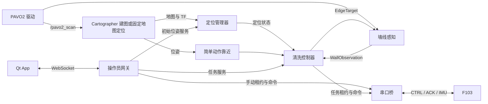

# 项目架构与代码导读

核对日期：2026-11-09，源码基线 `9db6798`。本文依据当前源码、launch、YAML 与测试整理。操作入口见[根 README](../README.md)，目标机安装见[部署指南](../DEPLOY_NANO.md)。历史验证记录只说明当时的测试结果，不能用来证明当前实船状态。

## 1. 项目组成与依赖

项目是 ROS 2 Humble 水面清洗机器人系统：Nano 执行传感器接入、建图定位、任务控制和串口通信；Windows Qt App 通过 WebSocket 操作 Nano，不需要 ROS。底层 F103 固件不在本仓库，`maps/` 也不纳入 Git。

| 包或目录 | 主要代码 | 职责 |
|---|---|---|
| `f1_lidar_driver` | [pavo2_scan_node.cpp](../src/f1_lidar_driver/src/pavo2_scan_node.cpp)、`vendor/pavo2_sdk/` | 连接雷达、发布扫描，不发布安装 TF |
| `f1_mapping_bringup` | [lidar_mapping.launch.py](../src/f1_mapping_bringup/launch/lidar_mapping.launch.py)、`config/pavo2_2d.lua` | Cartographer 纯雷达建图、地图发布、平面安装 TF |
| `f1_localization` | [localization_node.py](../src/f1_localization/f1_localization/localization_node.py)、`localization.py`、`map_io.py` | 冻结地图、初始位姿、轨迹生命周期、定位门控和栅格读取 |
| `f1_pool_cleaning` | [controller_node.py](../src/f1_pool_cleaning/f1_pool_cleaning/controller_node.py)、`autonomous.py`、`mission.py`、`map_profile.py`、`open_route.py` | 矩形任务及两类任务共用的简单靠近、沿墙、覆盖、感知实现 |
| `f1_l_cleaning` | [controller_node.py](../src/f1_l_cleaning/f1_l_cleaning/controller_node.py)、`route.py`、`topics.py` | 继承共享控制器，提供开放多段路线及 `/l_cleaning/*` 接口 |
| `f1_nano_bridge` | [node.py](../src/f1_nano_bridge/nano_ros_bridge/node.py)、`session.py`、`protocol.py`、`transport.py` | 控制租约、协议编解码、串口、CTRL/ACK、IMU 遥测 |
| `f1_interfaces` | `msg/`、`srv/` | 公共消息与服务定义；修改后需要重建使用方 |
| `f1_operator_gateway` | [node.py](../src/f1_operator_gateway/operator_gateway/node.py)、`task_control.py`、`runtime.py`、`map_store.py`、`tracks.py`、`diagnostics.py` | 手动会话、任务操作、受管进程、地图保存、轨迹遥测与诊断历史 |
| `operator_app` | [window.py](../operator_app/window.py)、`transport.py`、`map_canvas.py`、`mapping_panel.py`、`diagnostics.py` | Qt 界面、WebSocket、地图交互、建图选图与诊断日志；不持有硬件 token |

`f1_localization` 依赖接口和建图配置包，建图配置包再依赖雷达驱动。因此 `--packages-up-to f1_localization` 当前构建四个仓库包；`--packages-up-to f1_operator_gateway` 构建全部八包。构建依赖并不意味着 launch 会启动所有依赖节点：雷达始终独立运行。

## 2. 数据与控制流



图中的网关任务服务调用与初始位姿调用分别进入控制器和定位管理器。IMU 由桥发布，但当前建图和固定地图定位均不融合 IMU 或轮速。TF 链为 `map → odom → base_link → pavo2s_frame`；雷达静态安装参数来自 `f1_mapping_bringup/config/lidar_planar.yaml`。建图 Lua 的跟踪帧为 `pavo2s_frame`，纯定位 Lua 的跟踪帧为 `base_link`，对外船体位姿都使用 `map → base_link`。

2026-11-11 起桥接使用 F103 v3，主电机输出为整数 0–100，固件按方向和电机组混控，CH06=`1050+9*p`、PWM 偏移=`4*p` μs。网关/Windows 通过 `continuous_drive_percent_v1` 与动态 `drive_output.available` 表示连续输出能力；实际使能还需新鲜且兼容的 CTRL、ACK、中性握手和租约。版本不匹配进入 `INCOMPATIBLE`，恢复后重新申请，旧动作不会恢复。RC v2 原始14通道独立进入诊断，不作为 Nano 控制输入；CTRL 保留目标 PWM 与接受 ACK 的语义。新 25% 输出比旧 25 档的 PWM 偏移小，自主动作首批固定新25%，尚未拆分各动作参数或加入变力度控制。

## 3. 入口选择与进程归属

| 入口 | 启动内容 | 使用前提 |
|---|---|---|
| `f1_lidar_driver lidar.launch.py` | 仅雷达驱动 | 没有同一设备的常驻驱动实例 |
| `f1_mapping_bringup lidar_mapping.launch.py` | 建图、地图发布、可选安装 TF/RViz | 已有扫描，未运行固定地图定位 |
| `f1_localization localization.launch.py` | 冻结地图定位和门控 | 地图三件套与扫描已准备 |
| `f1_pool_cleaning pool_bringup.launch.py` | 定位、bridge、矩形感知与控制器 | 传入适配矩形任务的 `map:=` |
| `f1_l_cleaning l_bringup.launch.py` | 定位、bridge、L 感知与控制器 | 传入含有效开放直墙链的 `map:=` |
| `f1_operator_gateway operator_gateway.launch.py` | 仅网关 | 复用已运行的 ROS 节点 |
| `f1_operator_gateway operator_bringup.launch.py` | 共享定位、bridge、可用任务及网关 | 指定已有地图，任务能力按几何校验决定 |
| `f1_operator_gateway operator_system.launch.py` | 常驻 bridge/网关，按 App 操作启动模式子进程 | 指定绝对 `workspace_root:=`，可无地图待机 |

清洗包的 `pool_cleaning.launch.py` / `l_cleaning.launch.py` 仅启动感知与控制器，默认配置仍需 `map:=`，并复用外部定位和 bridge。单独矩形定位前缀为 `/pool_cleaning`，单独 L 为 `/l_cleaning`，网关组合与受管入口为 `/f1_localization`。

受管入口通过 `runtime.py`、`managed_process.py` 和 `operator_mode.launch.py` 管理“待机／建图／固定地图定位与清洗”。建图和定位互斥，加载地图后重新发布初始位姿。地图导出由 `map_store.py` 保存同名 `.pbstream/.yaml/.pgm`，临时快照和日志的恢复规则见[网关说明](../src/f1_operator_gateway/README.md#地图文件与恢复)。

App 加载地图的启动链为 `operator_system.launch.py → runtime.py → operator_mode.launch.py → operator_bringup.launch.py`，最后启动共享定位及地图支持的清洗控制器；bridge 和网关沿用常驻实例。矩形 `/pool_controller` 与开放多边 `/l_controller` 是独立进程，各自读取 TF、检查反馈并上报任务状态；App 切换任务类型只是选择对应的任务状态和操作接口。

同一机器人仅启动一套 bridge 和地图/定位发布链。默认 launch 的 `output_enabled=false`；`pool_nano` 快捷脚本默认传 `true`，仓库 `f1-operator.service` 模板也设置 `F1_OUTPUT_ENABLED=true`。预览时要在使用的入口明确核对该值。所有入口均等待操作请求，不会仅因启动就自动清洗。

服务模板通过 `wait-operator-clock.py --offline-after 20` 先等 NTP；未同步时再要求合理本地日期和新的 5 秒稳定窗口。运行中桥接检测时钟故障后撤销租约、尽力发中性帧并以 75 退出；受管 launch 关闭，systemd 重新检查时间后启动至无地图待机。该恢复不沿用旧命令或任务，直接 launch 没有 systemd 自动恢复。完整条件与限流见[服务部署](../DEPLOY_NANO.md#app-建图选图与开机服务)。

## 4. 地图和参数如何进入控制器

1. `map_io.py` 解析地图文件、读取栅格和最大空闲连通域；定位由这些数据计算范围门控。
2. `map_profile.py` 推导矩形四边或开放直墙链（`open_route.py` 分段拟合与连接，默认最长链）；`map_profile <地图>` 可离线查看结果。
3. `PoolController._map_geometry()` 先要求对应任务的地图推导成功，再把几何值作为 ROS 参数默认值。
4. 参数 YAML 的显式几何值可以覆盖这些默认值，但不能绕过第 3 步的失败。启动文件传入的同名显式参数又会覆盖 YAML，例如 `output_enabled`、`start_policy` 和 `default_edge_id`。
5. `edge_task_enabled=true` 且传入地图时使用 `AutonomousMission`；无地图的旧任务/测试模式使用 `Mission`，必须自行提供完整几何，不能照搬默认 launch 省略地图。

默认配置不保存历史地图尺寸或 L 坐标。更换地图时更新路径并核对现场 YAML 是否残留旧覆盖；地图几何与船体、刷盘、墙距策略是不同配置来源。控制器主要参数为只读，修改后需要重启对应节点。

`operator_bringup.launch.py` 对将要启动的控制器显式解析配置：`rectangle_config` / `l_config` 为空时，分别使用已安装包中的 `config/pool_cleaning.yaml` / `config/l_cleaning.yaml`；非空路径必须是现存文件，目录或不存在的路径直接报错。此规则适用于 App 受管链和直接启动 `operator_bringup`；`localization_config` 的空值规则未变。2026-11-09 修复了受管父入口的空参数被子 launch 继承、抑制默认路径而跳过控制器 YAML 的问题，不再依赖内层 `DeclareLaunchArgument` 对空值补默认值。

标准两份控制器 YAML 均设置 `use_map_tf=true`、`require_localization_ready=true`，从 `map → base_link` 获取位姿并等待定位就绪。共享定位状态通过不等于两个控制器均可启动：各自还要求位姿源时间戳有效、不在未来，源数据年龄和距最近一次接收新位姿的时间均小于默认 `pose_max_age_sec=0.25` 秒，以及任务阶段、时钟、控制权等条件满足。因此两个任务的 `can_start` 可以不同。定位显示正常但某一任务被禁用时，应查该任务的 `start_blockers` 和实际运行参数，见[定位正常但开放任务不能启动](../DEPLOY_NANO.md#定位正常但开放任务不能启动)。此修复只纠正配置加载，不改变选墙与运动逻辑。

## 5. 自动任务和停止语义

`AutonomousMission` 负责左侧射线选墙、锁定最近投影点、关刷简单动作靠近和矩形起始边补齐；`Mission` 负责沿墙纠偏和原有相邻边后退右推/右转，以及新增前行出墙端、左移至新墙入口、左转。详细状态流见[清洗流程图](pool_cleaning/WALL_CLEANING_FLOW.md)。

默认 `left_ray` 沿船体 +y 选择第一面命中的有限墙段；公共角点按清洗方向与船头夹角选墙。无交点拒绝启动，不延长墙或回退最近墙。显式 `set_edge` 或 `start_policy=specified` 可覆盖。开始前检查定位和位姿，锁定墙及最近投影点，取得控制权后旋转、前后移动和侧移进入旧版合理起始范围，再确认墙面。没有路径搜索、足迹或雷达环境碰撞检查；控制租约、定位与通信期限仍生效。

当前墙距目标为 0.33 m，控制区间 0.32–0.36 m；刷盘与侧推默认幅度为 50%。滚刷在墙距合格且航向在 ±10° 内时推进，主电机在航向偏差超过 ±3° 时纠偏。默认提速关闭；启动前可经 `set_forward_boost` 设置四电推25% 输出辅助前进，运行中及暂停时锁定。只有 `FOLLOW` 且船中心距当前墙端沿程距离大于 0.80 m 才可提速，纠偏优先，进入近端后本墙段锁定关闭，矩形补洗也检查实际结束位置。此状态由共享 `Mission` 持有，App 经网关调用 SetBool 服务并等待状态确认；控制器重启/换图默认关闭。`transfer_side_percent` 控制右转换边侧推，`side_percent` 用于沿墙、初始侧移及左转换边侧移。

覆盖由 `coverage.py` 和 `AutonomousMission` 统计左刷接触中心线区间，默认缺口容差 0.05 m。矩形顺时针绕行后只补齐首次有效开刷位置之前的起始边，并重叠 0.10 m；不再规划其他缺口的补洗。开放任务只执行选中位置之后到墙链末端的路线，不返回、不补洗。`COMPLETE` 表示本次路线执行结束，`coverage_complete` 和剩余缺口单独报告。

| 操作或状态 | 行为 |
|---|---|
| `pause` | `PAUSED`，关闭输出并释放任务租约；需 cancel 后重新 start |
| `stop` | `STOPPED`，关闭输出并释放任务租约，保留进度快照；可 start 新任务 |
| `cancel` | `CANCELLED`，关闭输出并释放任务租约，另清除边关联与指定起始边 |
| 新的自动任务 `start` | 重新检查条件、重置进度并生成新 `run_id`，不支持断点续跑 |
| App `manual_stop` 或断线 | 停止网关手动会话；不会主动取消已运行的自动任务 |

原路径规划模块 `navigation.py` 已删除。简单靠近不执行栅格、船体/刷盘包络或扫描碰撞检查，也不检查所选墙的路径可达性；定位管理器仍检查扫描新鲜度与地图一致性，沿墙阶段仍要求有效墙观测。40 cm 停车阈值和 `STOPPED` 均不表示通过速度测量确认船体已经静止。

Windows App 仅绘制底图、实时船体位姿和实际任务轨迹。网关不再转换或上报雷达显示点，也裁剪 expected_track；控制器内部的目标计算、33 cm 目标墙距、32–36 cm 开刷范围、40 cm 停车参数及覆盖统计保持原有语义。核心遥测默认 10 Hz，实际轨迹独立最多 2 Hz 更新；受管定位底图首次加载后冻结，建图底图默认最多每 2 秒后台压缩更新一次。收发两端按类型保留最新快照，App 后台解码地图，遥测过期时隐藏实时位姿并保留历史实走轨迹。

## 6. 诊断数据的保存范围

网关 `diagnostics.py` 在内存中保留最近 50 条桥状态变化及手动停止事件，以独立 diagnostics 消息发送新增事件，hello 补发历史；App 按 `session/id` 去重并最多保留 2000 条，支持复制和导出。网关重启会清空网关历史，App 退出会丢失未导出的本地日志。受管模式子进程的持久日志另存于 `workspace_root/log/operator_runtime/<session_id>.log`，与这两类诊断历史不同。详见[App 日志说明](../operator_app/README.md#诊断日志)。

## 7. 验证和维护入口

ROS 包通过 `CMakeLists.txt` 注册 pytest/GoogleTest，使用 `colcon test` 执行；Qt 测试单独运行。仓库现有测试包含纯逻辑、模拟 ROS 服务、localhost DDS、WebSocket 以及合成扫描的 Cartographer 集成。固件测试默认读取 `under/F103firmware`，可用 `F1_FIRMWARE_DIR` 指定同版本源码，见[部署测试说明](../DEPLOY_NANO.md#7-nano离线测试)。

以下为可按需执行的几何与任务逻辑检查命令；本次文档更新未重新运行它们：

```bash
# 工作空间根目录，已完成构建
source /opt/ros/humble/setup.bash
source install/local_setup.bash
/usr/bin/python3 -m pytest -q --import-mode=importlib \
  src/f1_pool_cleaning/test/test_map_profile.py \
  src/f1_pool_cleaning/test/test_autonomous.py \
  src/f1_l_cleaning/test/test_route.py \
  src/f1_l_cleaning/test/test_mission.py
```

仓库保留简化接近逻辑、开放墙链扩展等不同版本的软件回归和现场反馈，见[验证记录](pool_cleaning/DEVELOPMENT_AND_ACCEPTANCE.md#7-测试和证据要求)。2026-11-08 主电机提速修改后重新构建三个相关包，清洗 340 项、开放任务 28 项、网关 104 项、Qt 17 项通过，共 489 项；这些是本地软件测试，未执行 Nano 部署或实船提速验收。此前开放墙链及基线文档核对记录保留在验证文档中。后续改动接口时检查消息生成与调用方；改动入口时检查参数转发、节点重复和输出默认值；改动地图/任务规则时同步更新包 README、部署步骤与验收流程。
