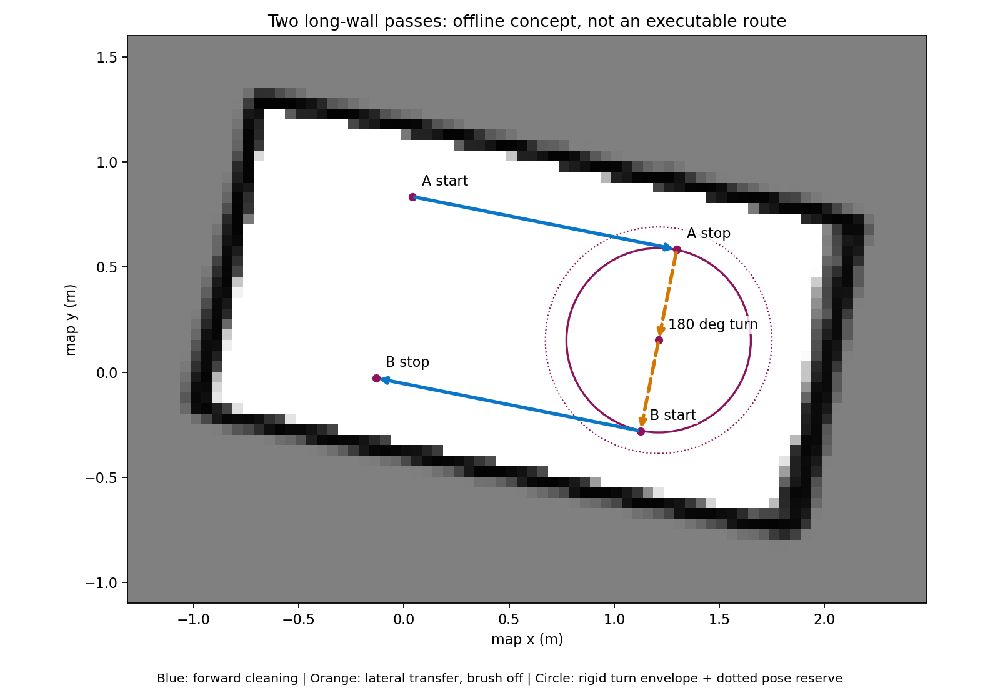

# 已建地图内的两条长边刷洗方案

日期：2026-10-21。状态：地图分析与开发设计；已新增独立功能包 [f1_rectangle_cleaning](../../src/f1_rectangle_cleaning/README.md)，提供两条长边状态机和侧推组合指令的无输出预览。实机输出、固定地图定位输入链路及自动换边尚未实现或部署。
本方案依据用户新思路：人工将船放到与长墙近似平行的位置，主轮纵向前进，第五推进器横向贴墙，接近短边时停车，再换到另一条长边。

2026-10-21 后续选择：采用纯雷达反馈，本矩形任务不引入 IMU 航向控制。Nano 部署与首轮感知验证见 [操作步骤](../../src/f1_rectangle_cleaning/DEPLOY_TEST_NANO.md)。

## 已确认与尚待确认

- 用户确认第五推进器为横向侧推，位于车体中心；实测描述为“反向将船推向左墙”。
- 将该结果记录为运动方向事实，不直接推断 ROS thrust_percent 的正负号。推离左墙方向的实机效果尚未得到明确确认。
- 静态数据沿用 MEASUREMENTS.md：前后各 28 cm，左侧刚性边界 28 cm、右侧 22 cm，未压缩刷尖左向 33 cm、接触点 x = 10 cm，目标压缩 1 cm；圆形刷盘直径 10 cm。刚性对称包络为 56 × 56 cm。
- 无转速、推力或接触力传感器。侧推位于几何中心可减小理想侧推附加偏航力矩，但不保证实际推力线穿过质心，也不能消除刷子摩擦与水动力造成的偏转。
- Nano 最近被用户确认为未开机，本轮未连接设备、未使能第五路、未发运动命令。

## 地图分析

源文件：backups/nano_maps/20261021_145054/lidar_20261021_145054.pgm，配套 YAML 和 pbstream 均已保存。

- 分辨率：0.05 m/格，图像 76 × 54 像素，画布 3.8 × 2.7 m；画布大小不等于池内尺寸。
- 可见空闲区域最大连通域约 3.87 m²，空闲格中心的最小外接矩形约 2.76 × 1.42 m。
- 排除角点后对四侧占用带取中位，得到近似墙带中心间距约 2.88 × 1.52 m，长轴相对 map x 约 -11.31°。
- 以上为栅格估计，墙带有厚度，不能当作尺量内尺寸，也不能用于毫米/厘米级刷头压缩判断。
- 候选换向中心的刚性全转角圆包络半径约 0.438 m（56 cm 方形包络各边扩张 3 cm）。再加入示意用的 0.10 m 定位余量后，其圆盘涉及的栅格均为已知空闲。
- 此检查只表明给定点的静态刚性圆包络有空间，尚未覆盖实际定位误差、转动中位移漂移、动态障碍、刷头完整几何或雷达盲区。

复现（PC 离线，无 ROS/串口输出；需要 Pillow、NumPy、OpenCV、PyYAML 和 Matplotlib）：

```bash
cd /home/bboss/new-nano/f1_mapping_ws
MPLCONFIGDIR=/tmp/f1-map-matplotlib /usr/bin/python3 tools/preview_long_wall_route.py \
  ../backups/nano_maps/20261021_145054/lidar_20261021_145054.yaml \
  --output-dir docs/long_wall_plan
```

生成 long_wall_route.png 和 map_analysis.json；后者明确标记 execution_ready=false，坐标不是可直接发送给船的航点。

## 路线与状态机

下面列出目标自动任务；当前新包第一版在 STOP_A 后进入 WAIT_MANUAL_TRANSFER，需人工换边后显式确认，再进入 APPROACH_B。MOVE_INWARD/TURN_180 仍为待开发阶段，不通过时间推算模拟成“已实现”。



蓝线表示两个相反方向的长边前进段；橙色虚线表示关刷后的侧移，圆圈表示在池中部转向的示意空间。两段前进时墙都在船的左侧。
图中的中心距短边 0.80 m 是演示用的提前终止位置，不是已标定停车距离；中心距长墙 0.32 m 来自刷尖 0.33 m 减目标压缩 0.01 m，实机必须用当前雷达墙线精调。
示意路线只覆盖两条长边的中间段，不宣称覆盖墙端、角落或全池。

1. WAIT_START：人工摆放近似平行，指定初始长边；检查定位、实时墙线、短边观测、桥接控制权、侧推方向。
2. APPROACH_A：主轮停止，第五推进器有限侧推，按实时墙距靠近；角度超限或刚性/压缩边界触发暂停，不依靠墙碰撞把船摆正。
3. FOLLOW_A：主轮前进，第五推进器按墙距误差调整贴墙输出。先关闭刷盘验证此阶段，再在接触窗口稳定后验证开刷；刷子接触力仍不可直接测得。
4. STOP_A：实时前方短墙净空达到预留阈值，或地图剩余沿程距离达到终止阈值时提前停车、关刷。地图和扫描结论冲突时暂停检查；不能只等固定坐标越线才停止。
5. MOVE_INWARD：主轮停止，通过已验证的向离墙方向侧推，使船移到有足够转向空间的池中部；保持航向监测。
6. TURN_180：关闭侧推与刷盘，以连续局部雷达位姿的相对转角和地图定位结果判断转向完成，采用连续展开的角度，不能靠固定转动秒数或首尾角度差越界判断。全程检查大角度扫掠空间；匹配退化或无法关联时暂停，不能继续沿用陈旧航向。
7. APPROACH_B：保持反向航向，通过朝船左侧的侧推接近第二条长边。
8. FOLLOW_B：以相反地图方向前进，左刷仍朝向墙面，重复长边距离控制与短边停车。
9. FINISH_SEGMENTS：两个计划段结束后所有执行器关闭，报告完成的段和未覆盖区域；不得报告全池清洁完成。

STOP_A 后是否已经物理停止，需要雷达短边距离变化、连续局部位姿变化及由此估计的平移/转动速度等有效反馈确认；只有下发 STOP 或 PWM 中立回报不足以证明。

## 地图与局部反馈分工

- PGM/YAML 用于静态几何、长短边标识及候选换边区域。
- 现有 pbstream 用于 Cartographer 固定地图定位：加载已有状态并使用 pure_localization_trimmer；启动时给定/核对初始位置和方向。矩形环境有对称性，仅靠自动全局匹配可能将两条长边混淆。
- 实时 LaserScan 的左墙距离/夹角、前方短边净空负责贴墙和停车，不从 5 cm 栅格直接推断 1 cm 压缩量。
- 转向角及短时偏航变化由连续局部雷达运动估计提供，近墙时以墙线夹角辅助核对。本任务不接入 IMU；大角度转向中不能要求一直观测同一条左墙，需独立的多帧匹配/定位输入及其质量检查。
- 使用连续局部运动估计做运动判定，避免把地图重定位/回环跳变当成真实加速或位移。
- 用户所说的“开环”主要对应执行器缺少速度/推力反馈；现有左墙算法已用扫描闭环更新决策。新方案仍需几何反馈，侧推不能固定大输出持续顶墙。

Cartographer 官方固定地图定位说明：
https://google-cartographer-ros.readthedocs.io/en/latest/going_further.html#localization-only

## 对现有实现的修改点

1. 增加固定地图定位入口，沿用已确认的雷达平面外参，加载已有 pbstream，保留纯雷达模式作为第一版输入。
2. 增加长短边任务描述及状态机，明确“地图端点距离”和“船头至短墙净空”的不同定义。
3. 增加左墙侧推控制：第五路的方向、有效死区、限幅、输出变化率、压缩超限停推及角度异常暂停。正负号必须由实机确认记录，不从“反向”字样硬编码。
4. 同一控制器通过同一 bridge 租约发布主轮、刷盘和第五路的组合命令。v2 编码已支持主轮前进与第五路同时输出，无需为此修改固件线协议；不要并行运行两个发布器争抢执行器。
5. 现有 direction_until 到期会同时关闭主轮和两个辅助路；若主轮脉冲间需要继续侧推，必须由新鲜观测生成新的“主轮 STOP + 第五路输出”组合命令，保留原时效合同。
6. 当前单墙控制器最多检查 0.20 rad 的有限转动，不能复用于 180° 掉头；新换边阶段必须独立检查完整扫掠与当前障碍，未知盲区不得当成自由空间。
7. 正常模式仍需明确的失联、RC 接管、反馈超时和异常恢复行为，暂停后不自动恢复运动。

已有 supervised_no_brush_trial.yaml 是“第五路也关闭”的旧试跑模式，不可当作本方案入口。新方案开发时保留其独立用途，不直接修改它去隐式开启第五路。

## 开发和验证顺序

- 先完成固定地图定位与长边标识的无输出回放/实景检查，验证初始墙段不会混淆。
- 实机先验证第五路两个方向以及“主轮前进 + 侧推”组合，不开刷；观察横移是否引入偏航，记录第五路命令正负号。
- 实现并验证 APPROACH_A、FOLLOW_A、STOP_A，单条长边能稳定完成后再增加换边。
- 单独验证 MOVE_INWARD 和 TURN_180，检查完整路径与漂移，不从小角度纠偏测试直接推断大角度换向可用。
- 接入第二条长边，最终才验证刷盘运行带来的负载、偏航和清洁效果。

当前位置和地图尺寸足以开展上述软件开发；侧推离墙能力、方向编码和停止/转动反馈质量仍是实际自动换边前需要确认的数据。
