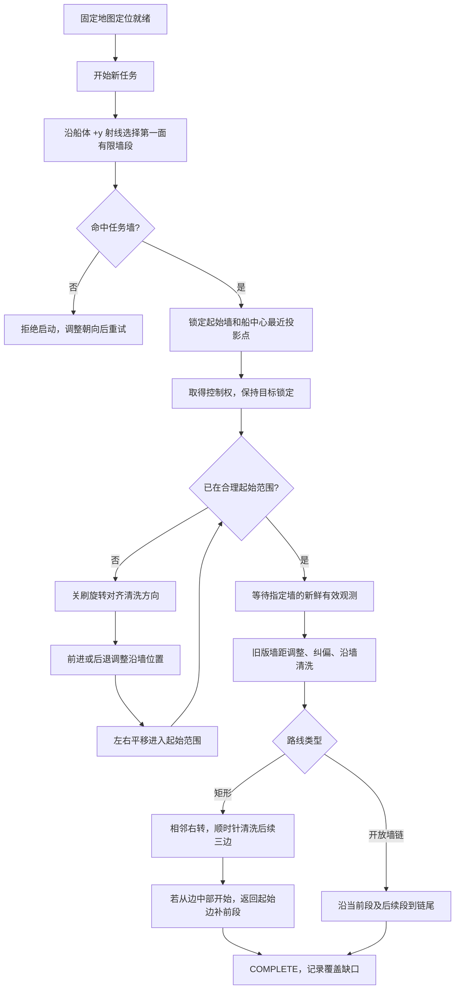
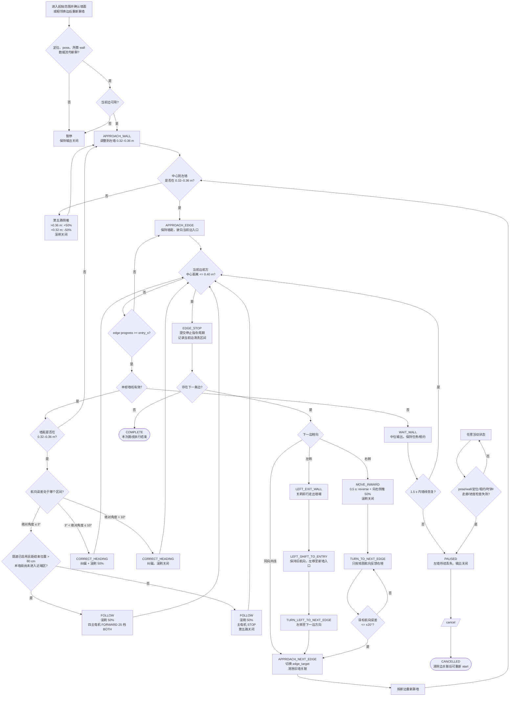

# 沿墙清洗流程图

2026-11-08 开放路线扩展：地图可生成多段直墙链；原右转保持不变，左转新增 `LEFT_EXIT_WALL → LEFT_SHIFT_TO_ENTRY → TURN_LEFT_TO_NEXT_EDGE → APPROACH_NEXT_EDGE`。换边期间关刷、旧墙目标无效，平移用位姿闭环，转后重新关联墙。未增加相邻转角和船体空间检查，原定位/租约/期限保护保留。下图的后退右推路径对应右转；开放路线遇左转走新增分支，详见 [开放任务说明](../../src/f1_l_cleaning/README.md)。

2026-11-08 更新：沿墙默认由 50% 滚刷前向推进；任务开始前可启用四主电机 25 档前进辅助。仅稳定 `FOLLOW`、无需纠偏且船中心距当前墙端大于 0.80 m 时提速；进入近端后本墙段锁定关闭，矩形起始边补洗同时检查实际结束位置。运行中和暂停时开关锁定；控制器重启/换图后默认关闭。纠偏、起点接近及换边保留原逻辑。

核对：2026-11-08，源码基线 `0c0e4e2`。带地图任务使用 `AutonomousMission` 射线选墙及简单靠近，随后复用 `Mission` 沿墙与相邻换边。没有路径搜索、地图足迹或雷达环境碰撞门控，靠近阶段不绕障；定位、控制租约、通信期限、停止和取消仍生效。基本测试反馈与软件回归记录见[开发与验收记录](DEVELOPMENT_AND_ACCEPTANCE.md#7-测试和证据要求)。

## 总体流程



角点使用 1 cm 容差，按规定清洗方向与船头夹角较小者选择，相同则按边 ID 排序。无交点不延长墙、不回退最近墙。`specified/default_edge_id` 和 `set_edge` 仍可覆盖射线选择。

起始参考位置采用船中心到有限墙段的最近点，并按入口/末端余量修正。默认到达范围为沿墙 ±10 cm、航向 ±20°、距墙段不超过 85 cm，墙在左侧、船在水侧，且未进入前墙 40 cm 停车区。连续满足 0.2 s 后确认墙面；已在范围内不先退到 60 cm。靠近期间只消费位姿反馈，确认墙面后才要求墙观测新鲜。

选墙采用有向清洗切线与船头的夹角，而不是无方向直线的锐角；与射线平行/共线的墙不算有效交点。最近投影点与射线交点是两个不同概念。起始参考沿程位置限制在 `entry_s_m` 到 `墙长 - front_stop_m - approach_along_tolerance_m - 0.01 m` 内；区间不存在时拒绝启动。取得租约或靠近期间发生漂移，不会重新选墙或更换参考点。

动作类型切换和运动方向反转先发一个停止指令周期，再继续动作；不把该周期解释为船体已物理停稳。进入范围后停止输出并等待时间戳晚于进入 `ACQUIRE_WALL` 时刻的新墙观测，最多等待 `wall_recovery_sec`；超时进入 `PAUSED`，漂出范围则重新靠近同一参考范围。

### 起始范围与覆盖参数

以下为当前默认值，在控制器 ROS 参数 YAML 中配置；修改后重启对应控制器。选择策略通过清洗 launch 的 `start_policy` 参数传入。

| 参数 | 默认值 | 用途 |
|---|---|---|
| `start_policy` | `left_ray` | `specified` 可指定边；`nearest_reachable` 仅为已弃用的 `left_ray` 别名 |
| `approach_corner_tolerance_m` | 0.01 m | 首次射线交点距公共端点的候选判定范围 |
| `approach_along_tolerance_m` | 0.10 m | 沿墙参考位置容差 |
| `approach_heading_tolerance_rad` | 0.349066 rad（20°） | 进入起始范围的航向容差；平移中的转向退出带另加 5° |
| `edge_select_max_distance_m` | 0.85 m | 起始范围内船中心到有限墙段的最大距离 |
| `approach_arrival_hold_sec` | 0.20 s | 连续满足到达条件的时间 |
| `wall_recovery_sec` | 1.5 s | 初始确认墙面及沿墙短暂丢墙的等待上限 |
| `approach_coverage_tolerance_m` | 0.05 m | 覆盖缺口容差及是否需要补起始前段的判据 |
| `approach_coverage_overlap_m` | 0.10 m | 矩形前段补齐的目标重叠长度，受有效区间末端限制 |

`can_start` 只表示当前启动前置门控通过。射线交点和起始区间在 start 请求中检查，因此按钮可用时仍可能因 开放墙链无交点或起始区间不足而拒绝启动。

矩形记录实际首次有效开刷位置，绕行后补齐其前段并重叠 10 cm；不搜索其他缺口的补洗路线。开放墙链从选中边的当前位置开始，只清后续部分，到链尾停止，不返回也不补洗；要执行全部边，应从首边入口附近开始。覆盖统计只记录连续有效开刷进度；路线完成不保证全墙已覆盖。

Windows App 显示起始墙、参考点、紫色起始范围、当前动作和矩形补前段阶段。`expected_track.navigation_path` 为空。`completion_scope` 区分矩形路线与本次剩余开放墙链，`coverage_complete` 和 `remaining_contact_intervals` 分别报告覆盖结果。

## 沿墙清洗与自动换边状态机

下图对应当前沿墙控制及左右换边分支。矩形外层按四边顺时针编排，必要时返回起始边补前段；开放墙链只沿选中边之后的路线到终点。路线执行完成与覆盖记录无缺口是独立字段。



### 控制规则与代码对应

| 流程节点 | 当前实现 |
| --- | --- |
| 起始点侧移 | `AutonomousMission._approach()`：第五路按侧移方向输出 ±50%；到达范围或切换动作时仍先停止。 |
| 左墙距离控制 | `Mission._update_edge()`：墙距大于 `0.36 m` 时第五路 `+50%`，小于 `0.32 m` 时 `-50%`，在区间内关闭第五路。 |
| 航向纠偏 | `Mission._update_edge()`：墙角绝对值超过 `3°` 进入 `CORRECT_HEADING`；正角发 `direction=3`，负角发 `direction=4`。 |
| 直行推进 | 默认 `50%` 滚刷；启动前启用提速后，仅稳定 `FOLLOW` 且距墙端 > 0.80 m 时主电机 FORWARD 25 档、BOTH。进入近端后本墙段锁定关闭；新位姿可在没有新雷达帧时撤销辅助，旧命令期限不延长。矩形补洗以墙端和实际完成位置中的较近者门控。超过 `3°` 时 LEFT/RIGHT 纠偏优先；起点接近及换边保持原逻辑。 |
| 滚刷门控 | 航向绝对值不超过 `10°` 且墙距在稳定区间时开刷 `50%`；纠偏和滚刷可以同时工作。 |
| 丢墙恢复 | `WAIT_WALL` 最多等待 `1.5 s`；期间输出中位命令，超时转 `PAUSED`。 |
| 端点判断 | 使用地图边投影的船中心到边端距离；小于等于 `0.40 m` 进入 `EDGE_STOP`。雷达前方观测只作为辅助安全信息。 |
| 右转换边 | `EDGE_STOP → MOVE_INWARD → TURN_TO_NEXT_EDGE → APPROACH_NEXT_EDGE`，保持原动作。 |
| 左转换边 | `EDGE_STOP → LEFT_EXIT_WALL → LEFT_SHIFT_TO_ENTRY → TURN_LEFT_TO_NEXT_EDGE → APPROACH_NEXT_EDGE`；两类换边均禁用旧墙目标，转后重新关联。 |
| 整场完成 | `AutonomousMission` 编排矩形一圈加起始边前段，或开放墙链后续路线。`COMPLETE` 表示路线执行结束，覆盖缺口单独报告，不追加路径搜索。 |
| 输出门控 | `controller_node.py` 在每个 tick 检查数据流、定位和 lease；异常进入 `PAUSED` 并调用 `_stop_outputs()`。 |

## 关键接口

```text
/pool_cleaning/localization_status  定位门控结果
/pool_cleaning/map_pose             固定地图位姿（use_map_tf=false 时）
/pool_cleaning/wall_observation     墙线感知结果
/pool_cleaning/edge_target          当前地图边生成的目标墙上下文
/pool_cleaning/start                启动任务
/pool_cleaning/pause                暂停并关闭输出
/pool_cleaning/stop                 停止并保留进度快照；再次 start 是新任务
/pool_cleaning/cancel               取消并清除边关联
/pool_cleaning/command_preview      执行器命令预览；live 模式另经 lease 发往 bridge
/pool_cleaning/status               状态、原因、边进度和覆盖区间
```

射线选墙位于 [geometry.py](../../src/f1_pool_cleaning/f1_pool_cleaning/geometry.py)，简单靠近与路线编排位于 [autonomous.py](../../src/f1_pool_cleaning/f1_pool_cleaning/autonomous.py)，沿墙与换边位于 [mission.py](../../src/f1_pool_cleaning/f1_pool_cleaning/mission.py)。沿墙默认参数位于 [pool_cleaning.yaml](../../src/f1_pool_cleaning/config/pool_cleaning.yaml)，`approach_*` 默认值由 `ApproachConfig` 定义并由控制器声明。

组合入口的定位状态为 `/f1_localization/localization_status`；开放任务的控制接口为 `/l_cleaning/*`。`stop/cancel` 均不支持断点续跑，App 的 `manual_stop` 仅停止手动会话。

> 说明：`COMPLETE` 表示本次路线执行结束；`coverage_complete` 单独表示记录的要求区间是否满足覆盖容差；`cleaned_intervals` 的统计基准是左侧滚刷接触中心线，不应单独解释为池底面积覆盖率。实船漂移、角部留白和实际清洁效果仍需现场验收记录。
