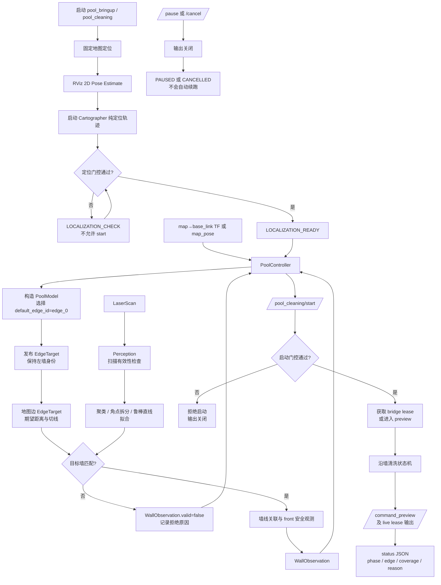
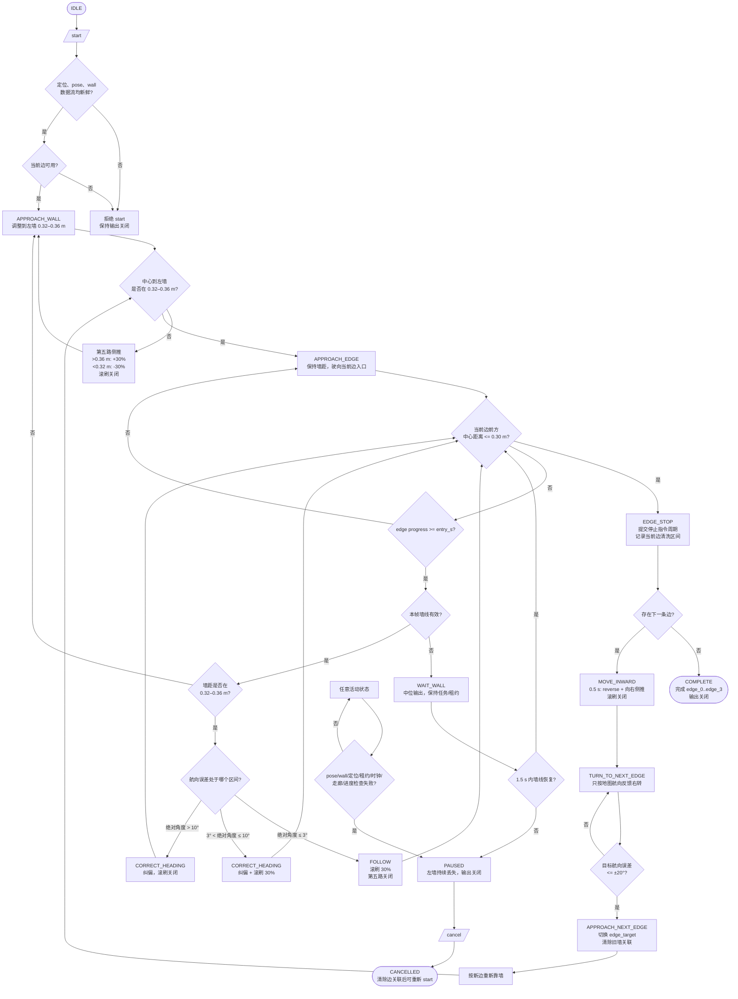

# 沿墙清洗流程图

本文档按当前仓库中的 `f1_pool_cleaning` 实现整理，描述从定位就绪、启动任务、左墙跟随，到四条边自动换边并结束的实际软件流程。图中的状态名与 `Mission.phase`、话题名和服务名保持一致。

## 总体流程



定位门控由 [localization.py](../../src/f1_localization/f1_localization/localization.py) 负责；墙线提取和关联由 [perception.py](../../src/f1_pool_cleaning/f1_pool_cleaning/perception.py) 负责；任务服务、数据新鲜度检查、租约和输出由 [controller_node.py](../../src/f1_pool_cleaning/f1_pool_cleaning/controller_node.py) 负责。

## 沿墙清洗与自动换边状态机



### 控制规则与代码对应

| 流程节点 | 当前实现 |
| --- | --- |
| 左墙距离控制 | `Mission._update_edge()`：墙距大于 `0.36 m` 时第五路 `+30%`，小于 `0.32 m` 时 `-30%`，在区间内关闭第五路。 |
| 航向纠偏 | `Mission._update_edge()`：墙角绝对值超过 `3°` 进入 `CORRECT_HEADING`；正角发 `direction=3`，负角发 `direction=4`。 |
| 滚刷门控 | 航向绝对值不超过 `10°` 且墙距在稳定区间时开刷 `30%`；纠偏和滚刷可以同时工作。 |
| 丢墙恢复 | `WAIT_WALL` 最多等待 `1.5 s`；期间输出中位命令，超时转 `PAUSED`。 |
| 端点判断 | 使用地图边投影的船中心到边端距离；小于等于 `0.30 m` 进入 `EDGE_STOP`。雷达前方观测只作为辅助安全信息。 |
| 自动换边 | `EDGE_STOP → MOVE_INWARD → TURN_TO_NEXT_EDGE → APPROACH_NEXT_EDGE`；换边期间旧墙目标无效，转弯完成后重新关联新墙。 |
| 一周结束 | `PoolModel.next_edge()` 返回空时，当前边记录完成并进入 `COMPLETE`，不再转移。 |
| 输出门控 | `controller_node.py` 在每个 tick 检查数据流、定位和 lease；异常进入 `PAUSED` 并调用 `_stop_outputs()`。 |

## 关键接口

```text
/pool_cleaning/localization_status  定位门控结果
/pool_cleaning/map_pose             固定地图位姿（use_map_tf=false 时）
/pool_cleaning/wall_observation     墙线感知结果
/pool_cleaning/edge_target          当前地图边生成的目标墙上下文
/pool_cleaning/start                启动任务
/pool_cleaning/pause                暂停并关闭输出
/pool_cleaning/cancel               取消并清除边关联
/pool_cleaning/command_preview      执行器命令预览；live 模式另经 lease 发往 bridge
/pool_cleaning/status               状态、原因、边进度和覆盖区间
```

状态机的主要实现位于 [mission.py](../../src/f1_pool_cleaning/f1_pool_cleaning/mission.py)，默认参数位于 [pool_cleaning.yaml](../../src/f1_pool_cleaning/config/pool_cleaning.yaml)。

> 说明：`COMPLETE` 表示软件状态机完成 `edge_0` 到 `edge_3` 的边段任务；`cleaned_intervals` 的统计基准是左侧滚刷接触中心线，不应单独解释为池底面积覆盖率。实船漂移、角部留白和实际清洁效果仍需现场验收记录。
