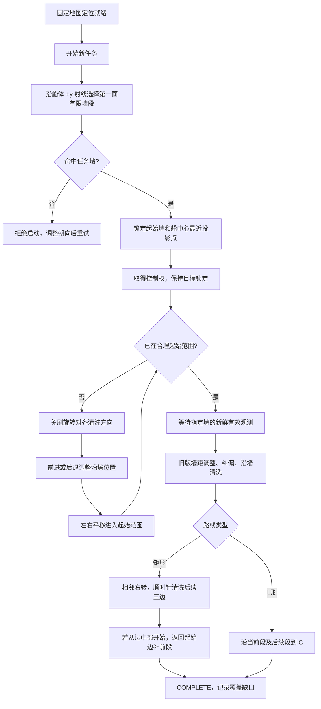
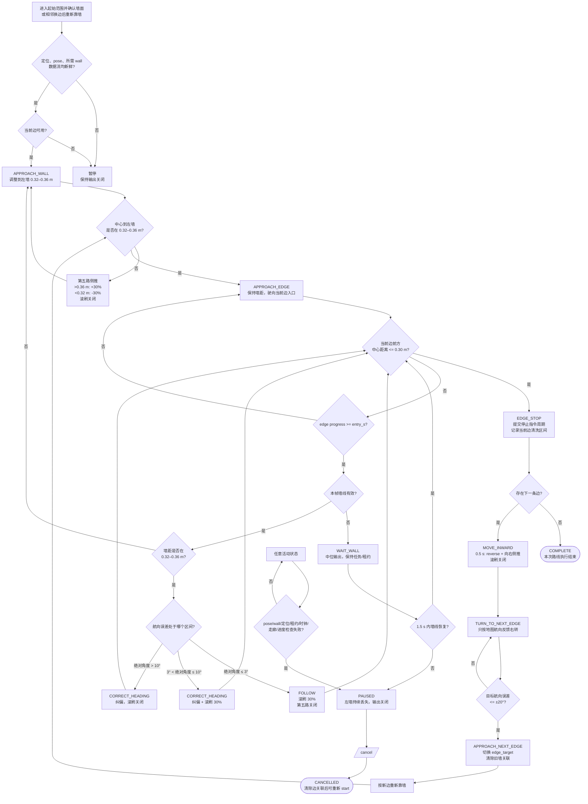

# 沿墙清洗流程图

核对：2026-10-31。带地图任务使用 `AutonomousMission` 射线选墙及简单靠近，随后复用 `Mission` 沿墙与相邻换边。没有路径搜索、地图足迹或雷达环境碰撞门控，靠近阶段不绕障；定位、控制租约、通信期限、停止和取消仍生效。

## 总体流程



角点使用 1 cm 容差，按规定清洗方向与船头夹角较小者选择，相同则按边 ID 排序。无交点不延长墙、不回退最近墙。`specified/default_edge_id` 和 `set_edge` 仍可覆盖射线选择。

起始参考位置采用船中心到有限墙段的最近点，并按入口/末端余量修正。默认到达范围为沿墙 ±10 cm、航向 ±20°、距墙段不超过 85 cm，墙在左侧、船在水侧，且未进入前墙 30 cm 停车区。连续满足 0.2 s 后确认墙面；已在范围内不先退到 60 cm。靠近期间只消费位姿反馈，确认墙面后才要求墙观测新鲜。

矩形记录实际首次有效开刷位置，绕行后补齐其前段并重叠 10 cm；不搜索其他缺口的补洗路线。L 形从 AB 中间开始只清后续 AB/BC，从 BC 开始只清后续 BC，到 C 停止，不返回也不补洗。覆盖统计只记录连续有效开刷进度；路线完成不保证全墙已覆盖。

Windows App 显示起始墙、参考点、紫色起始范围、当前动作和矩形补前段阶段。`expected_track.navigation_path` 为空。`completion_scope` 区分矩形路线与本次剩余 L 路线，`coverage_complete` 和 `remaining_contact_intervals` 分别报告覆盖结果。

## 沿墙清洗与自动换边状态机

下图保留旧版沿墙和相邻换边控制。矩形外层按四边顺时针编排，必要时返回起始边补前段；L 形只沿选中边之后的路线到终点。路线执行完成与覆盖记录无缺口是独立字段。



### 控制规则与代码对应

| 流程节点 | 当前实现 |
| --- | --- |
| 左墙距离控制 | `Mission._update_edge()`：墙距大于 `0.36 m` 时第五路 `+30%`，小于 `0.32 m` 时 `-30%`，在区间内关闭第五路。 |
| 航向纠偏 | `Mission._update_edge()`：墙角绝对值超过 `3°` 进入 `CORRECT_HEADING`；正角发 `direction=3`，负角发 `direction=4`。 |
| 滚刷门控 | 航向绝对值不超过 `10°` 且墙距在稳定区间时开刷 `30%`；纠偏和滚刷可以同时工作。 |
| 丢墙恢复 | `WAIT_WALL` 最多等待 `1.5 s`；期间输出中位命令，超时转 `PAUSED`。 |
| 端点判断 | 使用地图边投影的船中心到边端距离；小于等于 `0.30 m` 进入 `EDGE_STOP`。雷达前方观测只作为辅助安全信息。 |
| 自动换边 | `EDGE_STOP → MOVE_INWARD → TURN_TO_NEXT_EDGE → APPROACH_NEXT_EDGE`；换边期间旧墙目标无效，转弯完成后重新关联新墙。 |
| 整场完成 | `AutonomousMission` 编排矩形一圈加起始边前段，或 L 形后续路线。`COMPLETE` 表示路线执行结束，覆盖缺口单独报告，不追加路径搜索。 |
| 输出门控 | `controller_node.py` 在每个 tick 检查数据流、定位和 lease；异常进入 `PAUSED` 并调用 `_stop_outputs()`。 |

## 关键接口

```text
/pool_cleaning/localization_status  定位门控结果
/pool_cleaning/map_pose             固定地图位姿（use_map_tf=false 时）
/pool_cleaning/wall_observation     墙线感知结果
/pool_cleaning/edge_target          当前地图边生成的目标墙上下文
/pool_cleaning/start                启动任务
/pool_cleaning/pause                暂停并关闭输出
/pool_cleaning/stop                 停止并保留进度快照；再次 start 是新任务
/pool_cleaning/cancel               取消并清除边关联
/pool_cleaning/command_preview      执行器命令预览；live 模式另经 lease 发往 bridge
/pool_cleaning/status               状态、原因、边进度和覆盖区间
```

状态机的主要实现位于 [mission.py](../../src/f1_pool_cleaning/f1_pool_cleaning/mission.py)，默认参数位于 [pool_cleaning.yaml](../../src/f1_pool_cleaning/config/pool_cleaning.yaml)。

组合入口的定位状态为 `/f1_localization/localization_status`；L 任务的控制接口为 `/l_cleaning/*`。`stop/cancel` 均不支持断点续跑，App 的 `manual_stop` 仅停止手动会话。

> 说明：`COMPLETE` 表示本次路线执行结束；`coverage_complete` 单独表示记录的要求区间是否满足覆盖容差；`cleaned_intervals` 的统计基准是左侧滚刷接触中心线，不应单独解释为池底面积覆盖率。实船漂移、角部留白和实际清洁效果仍需现场验收记录。
