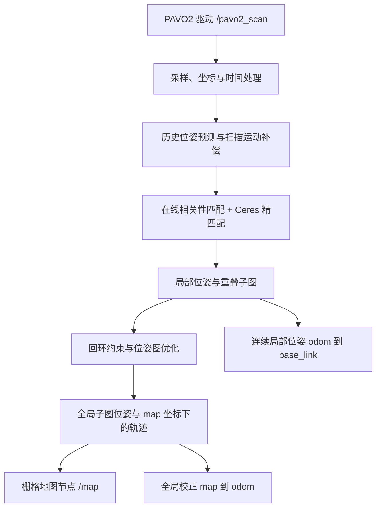

# 结合本包代码理解 Cartographer 纯雷达建图

这里的算法名称是 **Cartographer**。本仓库的 `f1_mapping_bringup` 是 ROS 2
启动与配置包，SLAM 核心由目标机安装的 `cartographer_ros` 和 Cartographer 提供，
并非在本仓库 Python 中实现。下文把本包实际配置与上游核心代码对应起来；
目标机 ROS 2 移植版本的接口和默认值仍应以其安装源码为准。

## 1. 本项目的数据流



`launch/lidar_mapping.launch.py` 中，`lidar_nodes()` 创建以下节点：

| 节点 | 对应代码 / 作用 |
| --- | --- |
| `base_to_lidar_planar` | `static_tf_arguments(...)`，发布雷达安装关系 |
| `cartographer_node` | 加载 `pavo2_2d.lua`，将 `scan` 重映射到 `/pavo2_scan`，运行 SLAM |
| `cartographer_occupancy_grid_node` | 将子图按全局位姿绘制为 `/map`；兼容两种安装版可执行文件名 |
| `mapping_rviz`（可选） | 显示地图、扫描和 TF |

雷达驱动独立运行。本包的 `scan_check` 只是消息质量诊断工具，
不是传给 Cartographer 的预处理节点，也不参与位姿估计。

## 2. 为什么只靠雷达能估计运动

一次 `LaserScan` 给出多个角度的距离，单个回波在雷达坐标中的平面位置为：

```text
angle_i = angle_min + i * angle_increment
point_i = (range_i * cos(angle_i), range_i * sin(angle_i))
```

设备运动后，同一堵墙在雷达坐标中的位置和角度会变化。算法寻找一个平移和旋转
`pose = (x, y, yaw)`，使新扫描与已构建的局部子图尽量对齐。
因此运动可以从环境几何中估计，无需先获得 IMU 或轮速里程计。
这里主要是**扫描与子图匹配**，不是只把相邻两帧做点对点匹配。

本包 `config/pavo2_2d.lua` 明确设置：

```lua
use_odometry = false,
num_laser_scans = 1,
rangefinder_sampling_ratio = 0.4,
-- 以下是 options 表外的算法设置：
TRAJECTORY_BUILDER_2D.use_imu_data = false
TRAJECTORY_BUILDER_2D.num_accumulated_range_data = 1
TRAJECTORY_BUILDER_2D.min_range = 0.1
```

以上片段摘取不同位置的配置，不能直接作为完整 Lua 文件运行。
0.4 是输入扫描消息的采样比例：驱动若为约 50 Hz，选入算法的扫描约为 20 Hz；
它不是把每帧点数保留 40%，也不保证计算机一定能实时完成 20 次处理。
当前一份扫描作为一份累计输入；是否插入子图还受运动滤波器等条件影响。

ROS 适配层将距离与角度转换成带时间信息的点云。上游对应
[`SensorBridge::HandleLaserScanMessage()` / `HandleLaserScan()`](https://github.com/cartographer-project/cartographer_ros/blob/master/cartographer_ros/cartographer_ros/sensor_bridge.cc)。

## 3. 没有 IMU，如何预测下一帧位姿

扫描匹配需要一个初始猜测。本包保留 `use_pose_extrapolator = true`。
没有 IMU 和外部里程计时，预测器从最近的扫描匹配位姿估计线速度与角速度，
再向下一时刻外推。直观近似是：

```text
velocity ≈ 最近两段位姿的位置变化 / 时间变化
predicted_position ≈ 最近位置 + velocity * 时间间隔
predicted_yaw ≈ 最近朝向 + 估计角速度 * 时间间隔
```

预测只是匹配初值，新的雷达观测会继续修正它。启动时历史不足，不能依赖预测立即准确。
上游 [`PoseExtrapolator::UpdateVelocitiesFromPoses()` / `AdvanceImuTracker()`](https://github.com/cartographer-project/cartographer/blob/master/cartographer/mapping/pose_extrapolator.cc)
包含无 IMU 时的回退分支；内部使用 `ImuTracker` 这个类名不等于订阅了真实 IMU。
无 IMU 分支采用固定竖直方向及历史位姿角速度，因此本模式依赖平面运动假设。

一帧雷达的各个点也有采集时间差。核心根据逐点时间和预测位姿补偿扫描期间的运动，
但效果受驱动时间字段和预测准确性影响；纯雷达在快速转弯、加减速时仍可能产生畸变。
对应 [`LocalTrajectoryBuilder2D::AddRangeData()`](https://github.com/cartographer-project/cartographer/blob/master/cartographer/mapping/internal/2d/local_trajectory_builder_2d.cc)。

`imu_sampling_ratio = 1.` 仍保留，因为上游
[`CreateTrajectoryOptions()`](https://github.com/cartographer-project/cartographer_ros/blob/master/cartographer_ros/cartographer_ros/trajectory_options.cc)
会读取这个字段。它只定义启用相应输入后的采样比例；本配置已经关闭 IMU 输入。

## 4. 局部 SLAM：先匹配，再更新子图

本包启用：

```lua
TRAJECTORY_BUILDER_2D.use_online_correlative_scan_matching = true
```

上游 `LocalTrajectoryBuilder2D::ScanMatch()` 的主要过程是：

1. 以预测位姿为中心，在一定平移、旋转范围内尝试候选，比较点云与子图的吻合程度。
2. 将相关性匹配的结果作为 Ceres 优化的初值，连续优化 `(x, y, yaw)`。
3. 把匹配出的位姿反馈给预测器；通过运动滤波后，再把扫描插入活动子图。

第一步提供更好的初值，也增加 CPU 消耗。第二步的代价由点与栅格的匹配误差、
平移偏离及旋转偏离等项组成，避免只追求点云重合而作出不合理的大幅位姿变化。
对应 [`CeresScanMatcher2D::Match()`](https://github.com/cartographer-project/cartographer/blob/master/cartographer/mapping/internal/2d/scan_matching/ceres_scan_matcher_2d.cc)。

对于通常使用的概率栅格，回波终点提高所在格子的占据概率，
射线经过且未击中的区域降低占据概率，未观测区域保留未知。
具体取决于安装版配置采用的栅格与插入器类型；本包没有覆盖这两项默认值。
概率更新实现见 [`ProbabilityGridRangeDataInserter2D`](https://github.com/cartographer-project/cartographer/blob/master/cartographer/mapping/2d/probability_grid_range_data_inserter_2d.cc)。

算法构建一系列有重叠的子图，而不是始终往一张无限增大的全局栅格中直接插入。
活动子图逐步交接，完成的子图停止接收新扫描；后台仍可调整其全局位姿。
对应 [`ActiveSubmaps2D::InsertRangeData()`](https://github.com/cartographer-project/cartographer/blob/master/cartographer/mapping/2d/submap_2d.cc)。

## 5. 全局 SLAM：回环与位姿图优化

局部匹配会累积误差，例如绕池一周后回到起点，却估计自己偏离了几十厘米。
后台尝试将轨迹节点中的扫描与历史子图匹配，匹配通过门槛后加入相对位姿约束。
图中的变量包括节点和子图位姿，约束包括子图内匹配关系及跨子图的回环关系。
优化器协调这些约束，修正全局轨迹与子图位置，减轻累计漂移。
对应 [`PoseGraph2D::ComputeConstraint()` / `RunOptimization()`](https://github.com/cartographer-project/cartographer/blob/master/cartographer/mapping/internal/2d/pose_graph_2d.cc)。

本包没有关闭后端回环，也没有覆盖其搜索窗口、接受阈值和优化间隔，
这些值来自目标机的默认 Lua。开启在线相关性匹配不等于启用回环；两者属于不同阶段。
回到起点也不保证一定成功闭环，仍取决于结构、重叠和匹配结果。
局部/全局分工参见 [官方算法说明](https://google-cartographer-ros.readthedocs.io/en/latest/algo_walkthrough.html)。

## 6. 雷达位姿如何变成车体中心位姿

本包的配置是：

```lua
tracking_frame = "pavo2s_frame",
published_frame = "base_link",
odom_frame = "odom",
provide_odom_frame = true,
publish_frame_projected_to_2d = true,
```

`config/lidar_planar.yaml` 给出 `base_link -> pavo2s_frame`：
`x=-0.2143195 m`、`y=0`、`yaw=π`。因此雷达位于车体中心后方约 21.43 cm，
雷达自身的正前方向与车体正前方向相反。静态 TF 将内部雷达位姿转换成车体中心位姿。

记 `T_A_B` 为把 B 坐标中的点转换到 A 坐标的变换，则：

```text
T_map_base = T_map_lidar * inverse(T_base_lidar)
```

输出链为 `map -> odom -> base_link -> pavo2s_frame`。
`odom -> base_link` 表达连续局部估计，`map -> odom` 承载全局优化的校正；
即使未接入外部里程计，也可以由 Cartographer 发布这条 TF 链。
这不代表本包另外发布了 `nav_msgs/Odometry` 消息或提供了清洁控制所需的速度接口。
车体中心全局位姿应查询 `map -> base_link`。

z/roll/pitch=0 是本项目二维约定，不能证明设备实际没有倾斜，
也不能补偿水面晃动造成的扫描平面变化。

## 7. `/map`、分辨率和保存文件

启动文件给栅格节点传入 `-resolution 0.05` 和 `-publish_period_sec 1.0`，
它将子图按全局位姿绘制成 ROS 栅格地图。相关上游逻辑见
[`OccupancyGrid` 节点的 `HandleSubmapList()` / `DrawAndPublish()`](https://github.com/cartographer-project/cartographer_ros/blob/master/cartographer_ros/cartographer_ros/occupancy_grid_node_main.cc)。
这两个参数控制输出栅格尺寸与发布周期，不是雷达频率、SLAM 更新率或精度保证。
内部子图分辨率另外由安装版 Lua 决定，本包没有显式覆盖。

`.pbstream` 保存轨迹、子图等 SLAM 状态，`.pgm + .yaml` 保存供显示或导航使用的栅格图。
启动入口默认新建轨迹，未实现自动读取旧状态；保存方法见 [操作说明](README_LIDAR.md)。

## 8. 对当前水池场景的含义

以下是根据观测几何作出的场景分析，仍需实测：长直墙通常能约束墙法向的距离和相对朝向，
但若视野里只有一段形状重复的直墙，沿墙方向的位移就较难区分。
可见墙角、端墙或其他稳定结构时，通常能补充这一方向的约束。
矩形环境的对称性也可能造成位置混淆。

因此应保持雷达基本水平、转向平缓且相邻扫描有足够重叠，并尽量观测墙角和端墙。
返回已走过区域有助于建立回环约束。地图看起来方正、稳定，仍不能代替
墙长、池宽、回到起点的位姿误差以及运行处理积压的实测。
